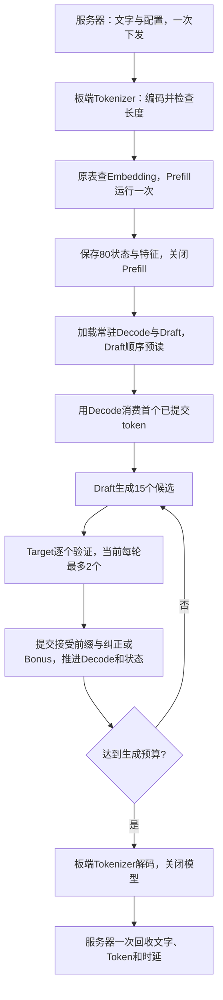

# 端到端执行流程

服务器只准备请求、部署和回收。请求启动后，文字编码、embedding查表、模型调用、接受判定、状态更新和文字解码均在板端完成。

1. 原tokenizer在服务器本地做长度准入，板端重新从文字编码并核对后才加载模型。
2. 短prompt补齐到物理64行，原Prefill执行一次，产生首token、80状态和8层特征。
3. Prefill关闭后，Decode与Draft各加载一次，在同一板端进程内交替运行。
4. Draft提案与Target greedy结果逐个比较；首次不匹配使用Target纠正token，全接受时生成Bonus，继续下一轮。当前是decode1串行验证，尚未使用批量verify。
5. 默认关闭dump：中间张量在内存流转，不逐token传输或写临时张量文件。仅启动时预读Draft OMC，预读时间计入加载耗时。

当前支持单条user聊天模板或raw文本、固定生成预算；尚未接入EOS早停和多轮会话。文字版组合已实机执行，生成内容正确性未验收。

正在新增的Draft路径：将anchor之前的新已提交特征分成C16或C64块，追加六层12份K/V缓存，再生成所选15／7／3／1档候选。旧历史的K已包含绝对位置RoPE，不重复旋转；临时anchor／MASK不进入持久缓存。C16／cap192／K15 AIR已导出；17／14接口的板端常驻适配已实现并通过主机模拟。新路径实机运行待回传，以上已运行结果仍使用旧S64 Draft。首次新路径保通仍限制总prefix≤64，未据此宣称Target长上下文已支持。

每个可执行的新Draft阶段都复用这条完整流程做接通测试，记录实际Draft模型版本和缓存进度。此类测试暂不检查语言质量或接受率门槛；Draft独立数值测试、单模型性能测试另行进行，新的批量verify等Target精度就绪后开发。

增量路径的12路KV保留在SDK输入张量中。一次同步执行成功、候选ID检查通过后，按每个head回填新增上下文区间，再推进缓存游标；历史行和未用行保持不变。运行器只取回Top1，不取回完整KV或hidden，不清零每轮输出。每新增一行回填24KiB，回填耗时单独汇总；这是运行器改动，模型仍使用原17输入／14输出ABI，实际板端效果待验证。
