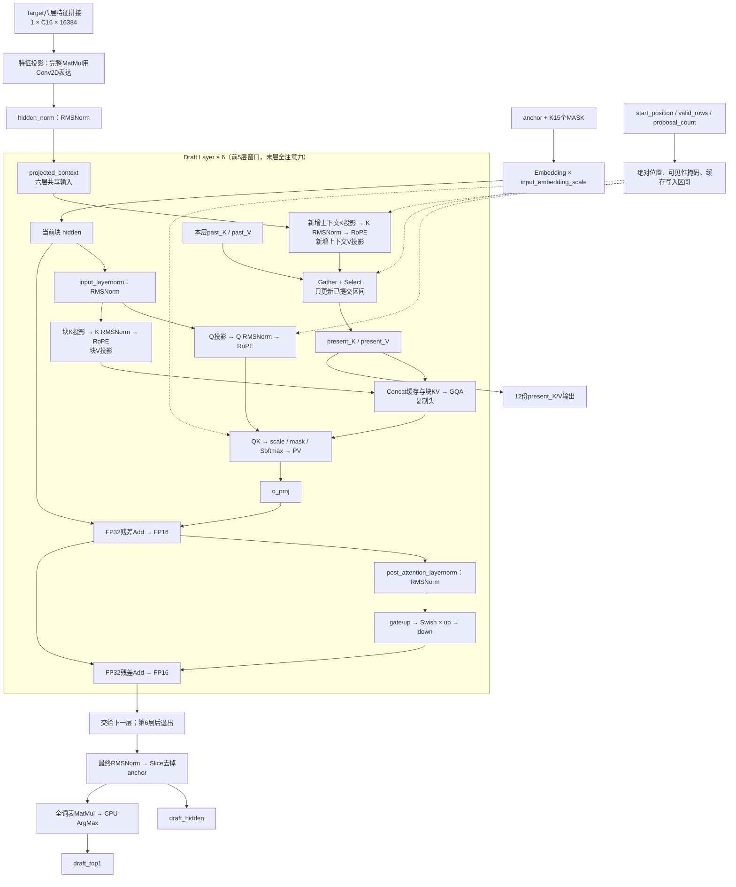
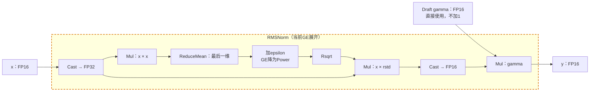
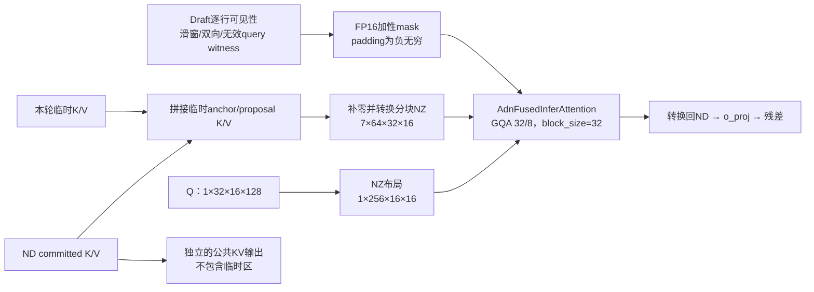
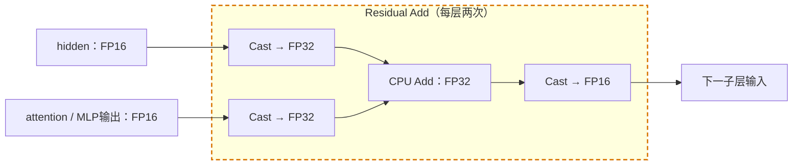
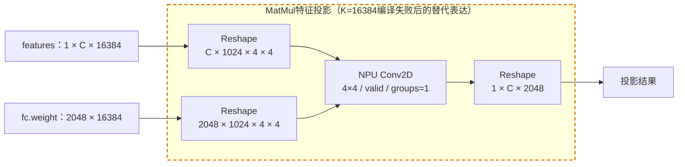
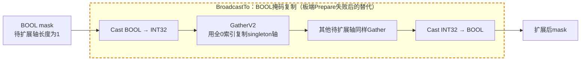
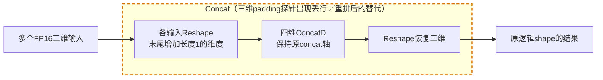
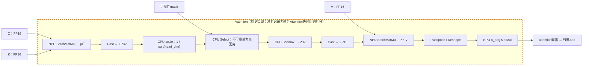

# 模型结构

当前部署使用Qwen3.5-35B-A3B文本主干与独立DFlash草稿模型，不包含视觉编码器或原checkpoint的MTP路径。

## Target

| 项目 | 配置 |
|---|---|
| 层数 | 40：30层Gated DeltaNet＋10层全注意力 |
| 层顺序 | 每4层为3层GDN＋1层全注意力 |
| Hidden / 输出词表 | 2048 / 248320 |
| MoE | 每层256个路由专家，Top-8，另有共享专家 |
| 全注意力 | Q/KV头16/2，head_dim=256 |
| GDN | Q/K头16、V头32，head_dim=128，卷积宽4 |
| 当前产物 | 原量化prefill64和decode1 OMC，外置权重 |
| 状态反馈 | 80份：30卷积状态＋30递归状态＋20 K/V缓存 |

每层执行：RMSNorm → GDN或全注意力 → 残差 → RMSNorm → MoE → 残差。40层之后经过最终Norm与词表输出头。

## Draft

| 项目 | 配置 |
|---|---|
| 模型 | 完整训练六层DFlash，内嵌权重OMC |
| 注意力 | 前5层窗口注意力，末层全注意力 |
| Hidden / MLP中间维度 | 2048 / 6144 |
| Q/KV头 | 32/8，head_dim=128 |
| Target特征层（从0开始） | 1、6、11、16、22、27、32、37 |
| 输入特征 | 每token拼接8层输出，宽16384，再投影到2048 |
| 一次生成 | block_size=16：1个anchor＋15个候选 |
| 当前增量档位 | C16新特征／cap192已提交KV／K15候选 |

当前测试每轮最多验证前2个候选；生成15个候选不等于接受15个。Target决定最终token，三类状态只沿已提交的token推进。Prefill/decode使用HIAI V2，Draft使用HIAI V1。

增量Draft每次接收C16／C64行新特征，独立设置KV总容量，六层共12个FP16缓存。候选计算档位由`--max-draft-tokens 15|7|3|1`选择，块长度分别16／8／4／2，保留同一套71份权重。当前C16／cap192／K15的17输入／14输出已上板接通；独立数值测试未通过原逐元素阈值，用户接受为阶段性诊断基线，详见[当前结果](results.md)。缩短候选块会改变末层双向注意力，不能把短档结果视为15档输出的简单截断。

参数来源：`specs/target-config.json`、`specs/draft-config.json`；部署继续复用原量化权重，未缩减层数或词表。

## Draft算子调用流程

以下画的是**当前已上板的GE增量图**。虚线框表示一个逻辑算子／模块的内部展开，框名不是编译OMC中的子图名；实际编译为27个CPUCL、26个NPUCL。CPU／NPU标签来自当前精度策略及用户回传profiling，不代表其他模型也只能放在同一设备。

图中Layer只展开一次。块内anchor／候选K/V仅参与本次attention，不写回committed cache。缓存写入只发生在新增的已提交上下文区间；`valid_rows=0`时不写缓存，但当前静态图仍会执行投影等计算，掩码不等于跳过算子。

### RMSNorm：展开的FP32统计链

当前增量图共32次逻辑RMS：入口1次，六层各5次（input、Q、新context K、block K、post-attention），最终1次。新K和块K共享gamma，但各自归一化。

FP32统计与归一化核心按当前策略放CPU，最后的FP16 gamma乘法可在NPU。这里首先是精度策略与原语表达；后续测试的内置`RmsNorm`虽编译到NPUCL，hidden／heads小图均在HIAI Load失败，所以尚未替换完整图。不能反推为“X90硬件不支持RMS”。

PyTorch候选用`torch_npu.npu_rms_norm → RmsNorm`，沿用Target CPro的算子接口；ND工程的`adn_rms_norm → AdnRmsNorm`是另一条接口。候选RMS在FP32完成gamma乘法后才转FP16，与上图先转FP16再乘gamma的舍入位置不同，需要重新比较；换前端本身不保证消除Load失败或降精度。

PyTorch的embedding、KV选行与query mask复制均使用INT32索引；GQA由本轮融合注意力内部处理。首次编译日志显示embedding的INT64 indices被所选DDK的GatherV2D拒绝，因此去掉了原实现中的`.long()`，这不是新增的算子拆分。实际导出AIR另逐节点检查，axis常量、注意力INT64长度端口与Gather indices分别处理。

### Target CPro 中可借鉴的调用

以下对照来自已核对版本的原始Target CPro源码，不把源代码调用当作当前Draft候选的编译或设备验证。

| 部分 | Target CPro 写法 | Draft 的复用边界 |
| --- | --- | --- |
| Token／位置索引 | `export_glm_model_qwen3_5_moe.py:334–339` 创建INT32的`input_ids`、`position_ids`和`new_kv_cache_pos` | 沿用INT32约定，embedding／KV Gather的indices不转INT64；最新Draft源码已如此修改，旧AIR必须重新导出 |
| Embedding | 导出入口设`embedding_in_omc=False`；量化路径在图外查INT8权重及scale，CPro wrapper接收后相乘 | Target这条路径不能证明Draft图内FP16 embedding Gather已在该DDK编译通过 |
| RMSNorm | `modeling_qwen3_5_moe_hiai_cpro.py:116–118,129–135` 调用`torch_npu.npu_rms_norm` | PyTorch Draft已使用同一接口。Target普通Norm的forward有`weight+1`，Draft权重直接是gamma，不能照搬权重变换 |
| KV更新 | 同文件`:283–296` 用INT32的块号与块内偏移调用`torch_npu.npu_cache_update_` | 可借鉴索引类型；Target采用block_size=32的分块缓存，Draft为ND committed KV和临时候选KV，不能直接替换其Gather／Select更新 |
| 完整注意力 | 同文件`:333–371` 调用`torch_npu.adn_fused_infer_attention`，带分块KV、NZ布局与mask | 本轮六层已接入；内部转换布局并携带Draft原有mask，仍待真实AIR／OMC／设备验证 |

PyTorch候选的注意力流程如下，公共KV输入输出仍为ND。C16／cap192／K15时，208个逻辑KV槽补齐为224个物理槽；已提交context之后到槽191之间的空洞、槽208～223的padding均被mask屏蔽。候选KV在槽192起的临时区，永不回写公共缓存。

长度端口沿用Target的INT64转换；Python调用的`pse_shift`按原Target converter接到GE的`all_seq_lengths_q`，GE `pse_shift`保持空，不把它当注意力bias。选择`inner_precise=2`只记录请求，不证明内部精度。融合改变了中间舍入边界，CPU布局模拟通过不等于厂商内核精度通过。本轮280步缓存／mask主机检查不替代重新编译、Load及板端数值测试。

### 残差Add：为避免NPU输入降精度保留CPU计算

普通Add的FP32小图曾被OMG插入两个FP32→FP16输入Cast，使用`executor_add_eltwise_half_nd`，最后再转FP32。因此当前采用CPU FP32残差。注册的`AddCustom`是**待测替代算子**，尚未进入上图；注册表列出FP32并不能证明实际JIT、编译和板端精度通过。

### 特征投影与BOOL广播：有失败记录的兼容改写

这是同一完整dot product的布局表达，**没有拆成多个部分MatMul求和**，没有额外中间算术截断；归约顺序仍可能带来数值差异。C16 profiling中该Conv为70.968ms，是当前明确热点。

历史板端日志在BOOL `BroadcastTo InitInput1Desc / SubGraph_0 Prepare`处失败；仅把shape控制改成INT32仍未解决，因此采用上述整数carrier。这个流程精确复制掩码值；不是用浮点近似代替布尔运算。

这是板端数值／布局问题，区别于Load失败；四维padding探针能正确复制两组head。改写只改变view，保持线性元素顺序，不增加浮点计算边界。它是通用GE降级规则，是否命中某一新图要看其实际Concat rank。

### Attention与MLP：本来就按原语构图

MLP同样是常规原语：`gate_proj(x) → Swish`，与`up_proj(x)`逐元素相乘，再做`down_proj`。RoPE使用位置／频率、Cos／Sin、Slice／Neg／Concat、两次Mul及Add；GQA用Gather重复KV头。没有证据表明这些都是某个融合算子上板失败后才拆开的。

### 改写原因与源码位置

| 逻辑算子 | 当前表达／处理 | 原因与边界 |
|---|---|---|
| 入口MatMul | Reshape → 4×4 Conv2D → Reshape | 选定OMG拒绝K=16384 MatMul；完整dot，无分块求和 |
| BOOL BroadcastTo | 整数Cast → Gather复制 → BOOL Cast | 有板端Prepare失败记录；精确复制 |
| RMSNorm | 平方、均值、epsilon、Rsqrt、乘法 | 原语＋CPU FP32策略；内置小图Load失败，尚未接入 |
| 残差Add | FP32 Cast → CPU Add → FP16 | 普通NPU Add有编译降精度实证；AddCustom待测 |
| FP16三维Concat | Reshape为四维 → ConcatD → Reshape | 板端padding探针丢行／重排，四维对照正确；数值／布局问题，非Load失败 |
| Attention / RoPE / MLP / KV写入 | 各自基础算子组合 | 正常构图／算法实现；未证明是融合算子失败后的替代 |

源码：[增量图](../model/qwen35_moe_dflash/graph/incremental_draft.py)、[RMS与Attention](../model/qwen35_moe_dflash/graph/draft.py)、[GE降级](../model/qwen35_moe_dflash/graph/cpp.py)、[Conv投影](../model/qwen35_moe_dflash/graph/dense_projection.py)、[PyTorch候选](../model/qwen35_moe_dflash/draft/incremental/torch_model.py)。旧S64图的CumSum→移位加法扫描不在当前增量主流程中。

## 代码结构

`model/qwen35_moe_dflash/` 顶层保留模型、配置、算子接口、特征接口和CLI；其余实现按职责分组。

| 目录 | 职责 |
|---|---|
| `execution/` | 运行配置、文字输入输出、板端启动与回收、运行目录管理 |
| `draft/` | Draft准备、编译检查、profiling；`incremental/`负责增量KV |
| `target/` | 原Target适配、输入输出及状态映射 |
| `graph/` | GE图构建与算子降级 |
| `toolchain/` | AIR、OMG、OMC与工具链适配 |
| `reference/`、`fused/` | 参考数学实现、权重读取与融合实现 |
| `common/` | 文件、资源配置与公共工具 |
| `targets/cpro/scripts/` | 主流程准备、导出、编译、执行命令 |
| `targets/cpro/tools/` | 按需使用的板端profiling等诊断工具 |
| `targets/cpro/runtime/` | 板端C++运行器与词表实现 |

本地回归测试和模拟设备代码在仓库外维护，不发布到GitHub。已结束的一次性测试入口删除，历史代码通过Git历史查阅。日常运行继续使用完整流程页的命令。
