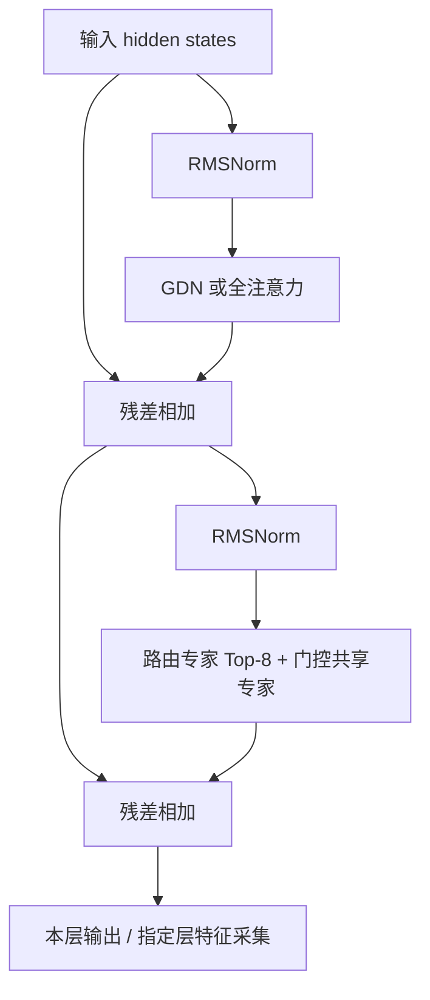
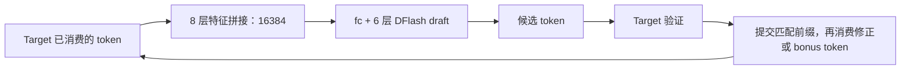

# 模型结构与 DFlash 接口

本工程的目标模型是 **Qwen3.5-35B-A3B 的文本主干**，搭配独立的 DFlash draft。
目标模型负责最终 token 判定；draft 利用目标模型的中间特征提出候选 token。
多模态视觉编码器和 checkpoint 中的 MTP 层不属于当前这条文本 DFlash 集成路径。
当前完成范围见[项目状态](current-status.md)，操作入口见[文档首页](README.md)。

以下参数来自本地锁定的 [target 配置](../specs/target-config.json)、
[draft 配置](../specs/draft-config.json)和[上游版本记录](../specs/upstream.lock.json)。
板端 tiny 探针使用缩小配置，不能把其张量尺寸当成完整模型尺寸。

## Target：40 层混合注意力 MoE

| 项目 | 完整模型配置 |
|---|---|
| 隐藏维度 / 词表 | `2048` / `248320` |
| Decoder 层数 | `40`：`30` 层 Gated DeltaNet（GDN）+ `10` 层全注意力 |
| 层顺序 | 每组 4 层依次为 GDN、GDN、GDN、全注意力；共 10 组 |
| 全注意力 | Q 头 `16`、KV 头 `2`、每头 `256`；GQA；partial RoPE 比例 `0.25` |
| GDN | Q/K 头 `16`、V 头 `32`；K/V 每头 `128`；因果卷积核宽 `4` |
| MoE | 每层 `256` 个路由专家，每 token 选择 `8` 个，另有门控共享专家 |
| 专家中间维度 | 路由专家与共享专家均为 `512` |
| Norm / 激活 | RMSNorm，epsilon=`1e-6`；SiLU/SwiGLU |

单个 decoder block 的计算顺序如下，两条注意力分支按层类型二选一：



全注意力分支执行 Q/gate、K、V 投影，Q/K norm、partial RoPE、因果 GQA，
再乘 sigmoid gate 并做输出投影。40 层之后还有最终 RMSNorm 和词表输出头。
当前新实现中的主 norm 使用一次 `1+w`，GDN 的 gated norm 直接使用 `w`，
避免把用户分析文档中指出的权重重复折叠问题带入新路径。

## GDN 融合覆盖哪里

完整 GDN 分支为：

```text
输入 norm 后的 hidden states
  ├─ qkv 投影 → conv 历史拼接 → depthwise causal conv → SiLU → 拆 Q/K/V
  ├─ a/b 投影 → decay g、记忆门 beta
  └─ z 投影 → 输出门控

Q/K/V + g/beta + recurrent state
  → ChunkGatedDeltaRule（含可选的 Q/K L2）
  → core_attn + 新 recurrent state
  → gated RMSNorm × SiLU(z) → out_proj
```

`ChunkGatedDeltaRule` 是上述 **delta-rule core** 的融合算子。
卷积状态拼接由 `LinearAttentionConvstateUpdate` 承担；卷积计算、投影和 gated norm
仍是各自的计算边界。完整配置的 Q/K 在进入 core 前由 16 头展开到 32 个 V 头，
所以文档的 core 输入为 `[B,S,32,128]`。开启 kernel 内 Q/K L2 时，外部不重复归一化。

直接 GE 版本可独立开关 `gdn`、`conv_state`、`rms` 三种融合角色。
具体端口与限制见[GE 实现说明](ge-guide.md)及用户提供的
[算子与量化分析 §4.6](qwen35-moe-operators-and-quantization-analysis.md#46-ge-端口信息速查custom_op-注册口径)。
用户文档面向 `Ascend310P3`，端口描述本身不证明当前目标 DDK 已安装兼容 kernel。

## DFlash：8 层特征进入 6 层 draft

目标层 ID 使用 **从 0 开始的 decoder 层索引**：
`[1,6,11,16,22,27,32,37]`。每个采集点是完整 decoder block 的输出，包含该层的
注意力、MoE 与残差；不是只采 GDN core。按上述顺序拼接后，每 token 的特征宽度为
`8 × 2048 = 16384`，再通过 draft 的 `fc` 投影到 `2048`。

Draft 有 6 个 decoder block：前 5 层为窗口注意力（窗口 `4096`），最后 1 层为全注意力；
Q/KV 头数为 `32/8`、每头 `128`、MLP 中间维度 `6144`。锁定配置的 DFlash 块宽为 `16`；
块宽与一轮实际接受的 token 数是不同概念。



采集合同见 [target_features.py](../model/qwen35_moe_dflash/target_features.py)，
draft 形状定义见 [config.py](../model/qwen35_moe_dflash/config.py)。

## 三类 target 缓存与接受前缀

| 缓存 | 归属 | 新实现的逻辑表示（batch=1） |
|---|---|---|
| 卷积历史 | 每个 GDN 层 | `[1,8192,3]`，保留核宽 4 所需的前 3 个时间位置 |
| recurrent state | 每个 GDN 层 | `[1,32,128,128]`，承接 delta-rule 递推 |
| K/V cache | 每个全注意力层 | K、V 各 `[1,2,T,256]`；T 为已消费 token 数 |

这是逻辑 ND 表示。用户文档的分页/NZ KV 和 convstate 原生输出需通过明确的适配转换，
不能直接按同名张量互换。状态 dtype 也由接口明确声明；当前独立路径默认 FP16 recurrent
缓存，文档中的 FP32 状态输出需要显式处理边界转换。Draft 的上下文缓存另属 draft 调度管理。

投机验证会计算尚未接受的 token。只接受前 r 个时，三类 target 缓存、位置及对应特征
都必须回到第 r 个 token 之后的状态；不能提交整段候选的最终状态。
KV 可以按时间轴管理，GDN recurrent state 没有可供截断的 token 轴，需保留中间状态或重算。
随后还要从已提交状态消费 target 的修正 token（全接受时为 bonus token）。

## 仓库中两条实现路径

| 路径 | 当前状态语义与实现范围 |
|---|---|
| 原始 GE target/draft + HIAI ABI v2 | 每轮对输入前缀重算；没有用新 fork 的显式三类状态替换原运行时 |
| 独立 PyTorch fork `fused/` | 模型结构及缓存/session 主机验证；逐 token 保存提案状态并提交接受前缀；文档三角色可选适配已实现，真实后端待验证 |
| 独立直接 GE `ge_fused/` | 显式缓存输入/输出，按静态 S/T 构图；文档派生的三个融合角色端口已接线，尚未完成真实导出/编译/板端验证及 native DFlash 状态调度 |

后两项是新实现的两个入口。PyTorch session 是状态语义参考，不能直接当作 GE/HIAI 运行时。
详细说明见[独立缓存模型](pytorch-guide.md)；主机数学参考位于
[reference/fused_ops.py](../reference/fused_ops.py)。当前新路径使用未量化 FP16 prepared 权重；
用户文档的 W4A8/I4ZN 方案另需量化权重与算子适配，不在本页展开。
