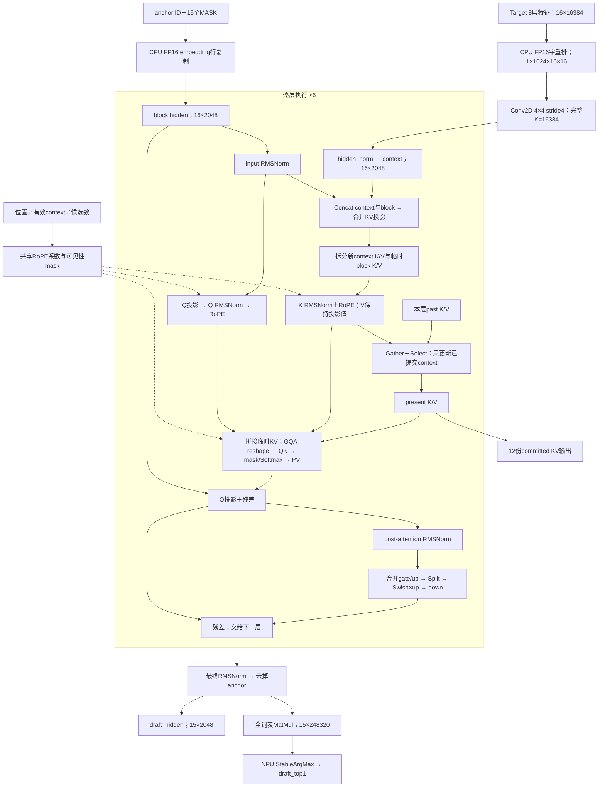

# 模型结构

当前部署保留原40层量化Target和完整训练六层DFlash。下面的Draft结构对应归档的 **C16／cap192／K15、约60ms packed基线**，不是早期手写GE图。原始checkpoint配置中的BF16权重已在部署准备阶段转换为FP16；不删层、不裁词表。

## Target

[交互式 Target 结构图 HTML](assets/target-architecture-interactive.html)：在 GitHub 文件页下载原始文件，使用浏览器打开即可，无需联网。可以选择 Prefill／Decode／双列对比，点击 L0–L39 逐层展开两次残差、注意力、MoE 和状态流；点击算子查看该层、该阶段的原始指标，并导出当前展开区域为 SVG。GitHub 文件预览本身不执行 HTML。

每层的连接是：

```text
u[i]   = h[i] + Mixer[i](InputNorm[i](h[i]), state[i])
h[i+1] = u[i] + MoE[i](PostNorm[i](u[i]))
```

R1 保留层输入 h[i]，绕过 InputNorm 和注意力；R2 保留第一次 Add 的输出 u[i]，绕过 PostNorm 和 MoE。**本层第二次 Add 的结果直接作为下一层输入，层间没有第三次 Add。** 原导出循环逐层执行 `hidden_states = layer_outputs[0]`，并为每层传入自己的 `past_key_values[idx]`；状态反馈连接下一时间步的同一层，与主干的层间传递分开。

Prefill 与 Decode 共用这套 40 层结构。Prefill 处理整段 token，首次调用使用初始化状态，续接时使用已有状态；Decode 每步处理一个 token，读取并更新各层 ConvState、recurrent state 或 K/V。

交互图提供两个独立批次：默认 **FP16 scale 候选 42 项**（Prefill／Decode 各 21 项，relative-L2 >1% 为 1／3 项）；可切换 **修改前 146 项基线**（各 73 项，>1% 为 28／23 项）。候选中只测 QLinear 和 Cache 浮点索引，其他节点为灰色；四个 Cache 整数图编译失败，无数值。38 个 QLinear 有 36 个低于 1%，剩余 L0 out_proj 为 1.3766%／1.7625%；Decode Cache 仍失败。

红色表示 **relative-L2 >1%（原始比值 >0.01）**，青色表示已回传误差 ≤1%，并非新增验收通过。橙色 ConvState 是此前小图编译阻塞记录，本轮未测。[静态 SVG](assets/target-architecture-accuracy.svg)保留旧快照，新的数据请从 HTML 导出，导出标题带当前批次。

数据日期：2026-11-12。[候选 CSV](../specs/target-qlinear-cache-candidate-metrics-20261112.csv)、[修改前 CSV](../specs/target-boundary-metrics-20261112.csv)各自保留原状态；[算子族风险 CSV](../specs/target-operator-accuracy-risk.csv)逐行标明证据范围，不合并成一次整图运行。

数值证据仅覆盖 L0–L3 独立小图的 Prefill T256／Decode T1，其余层、MoE 和模型 IO 不继承这些数值结论。成功整图 T64 是另一用例，跨调用状态反馈尚未由本批小图验证。原始验收状态保持不变；图为原 Target 的模型语义结构，实际编译融合及节点名以 AIR／OMC dump 为准。不含 Draft、视觉编码器和 MTP。

| 项目 | 配置 |
|---|---|
| 层数 | 40：30层Gated DeltaNet＋10层全注意力 |
| 层顺序 | 每4层为3层GDN＋1层全注意力 |
| Hidden / 输出词表 | 2048 / 248320 |
| MoE | 每层256个路由专家，Top-8，另有共享专家 |
| 全注意力 | Q/KV头16/2，head_dim=256 |
| GDN | Q/K头16、V头32，head_dim=128，卷积宽4 |
| 当前产物 | 原量化prefill64和decode1 OMC，外置权重 |
| 状态反馈 | 80份：30卷积状态＋30递归状态＋20 K/V缓存 |

每层执行：RMSNorm → GDN或全注意力 → 残差 → RMSNorm → MoE → 残差。40层之后经过最终Norm与词表输出头。

## 当前 Draft

| 项目 | 归档版本 |
|---|---|
| 前端／目标 | PyTorch → TorchAir → CPro OMG；kirinx90，DDK 100.520.020.010 |
| 层数 | 6；前5层滑窗因果注意力，末层全注意力 |
| Hidden／MLP中间维度 | 2048／6144 |
| Q／KV heads；head_dim | 32／8；128（每组4个Q heads） |
| 词表／MASK ID | 248320／248077；保留完整LM head |
| Target特征层（0起始） | 1、6、11、16、22、27、32、37 |
| 特征投影 | 拼接宽16384 → 2048；完整K点积以4×4 Conv2D表达 |
| 新增context／committed KV容量 | 最多16行／192行 |
| 候选块 | 1个anchor＋15个MASK；一次输出15个候选 |
| 位置／滑窗 | RoPE theta=10000000；训练滑窗4096，当前缓存容量192 |
| 权重 | 原始prepared共71份；K/V和gate/up按输出通道拼接，embedding在CPU查表 |
| OMC | 内嵌权重、自包含，1791018585字节 |
| 当前状态 | 已有独立设备测量；原CPU数值门槛仍FAILED，未替换旧常驻接口 |

档位由manifest固定。源码仍支持K=15／7／3／1，但本次只归档K15；缩短块会改变末层双向注意力，不能把短档当作K15结果的截断。生成15个候选也不代表接受15个，最终由Target验证与提交。

## 输入、输出与缓存

下表按语义分组；**实际槽位以 `draft/omc/pytorch-abi.json` 为准**，不能按参数名排序。共17输入、14输出。

| 方向／名称 | dtype与shape | 含义 |
|---|---|---|
| 输入 target_features | FP16 `[1,1024,16,16]` | CPU将逻辑 `[1,16,16384]` 的512KiB原始FP16字重排为16个4×4空间块 |
| 输入 block_embeddings | FP16 `[1,16,2048]` | CPU复制anchor及15个MASK的原FP16 embedding行；scale=1 |
| 输入 start_position／valid_rows／proposal_count | 各INT32 `[1]` | 新context起点／有效行数／实际消费候选数 |
| 输入 past_k_i／past_v_i，i=0…5 | 各FP16 `[1,8,192,128]` | 六层已提交context的K/V |
| 输出 draft_top1 | INT32 `[1,15]` | 全词表Top1，只消费前proposal_count项 |
| 输出 draft_hidden | FP16 `[1,15,2048]` | 最终归一化后去掉anchor的hidden |
| 输出 present_k_i／present_v_i，i=0…5 | 各FP16 `[1,8,192,128]` | 只更新新增已提交context区间的完整KV bank |

KV写区间为 `[start_position, start_position+valid_rows)`，其余位置选择原缓存值。历史K已做RoPE，不重复旋转。anchor和候选K/V只供本次attention，不写入committed缓存。每层attention读取192个context槽＋16个临时块槽，共208行；mask屏蔽未用缓存和无效候选。`valid_rows=0`仍执行当前静态图中的投影，不等于自动跳过算子。

## 计算流程



图中的Layer表示循环体；第i层的block hidden进入第i+1层，projected context由六层共享。前五层保持因果／滑窗约束；末层有效block keys可双向可见。无效query保留anchor witness，避免无效行Softmax全被屏蔽。

- **投影合并**：每层context和block先合并行，K/V合并输出通道，一次MatMul后按原顺序拆回；gate/up同样合并输出通道。每个输出仍计算完整点积。
- **GQA**：Q由 `[1,32,16,128]` reshape成 `[1,8,64,128]`，KV为 `[1,8,208,128]`，scores为 `[1,8,64,208]`。不再显式复制四份KV head。
- **RMSNorm**：当前使用 `torch_npu.npu_rms_norm → RmsNorm`，共32次调用；直接用Draft gamma，不加1。源码请求FP32统计和gamma乘法后转FP16，区别于早期手写GE的舍入顺序；设备内部指令精度尚未证明。
- **Attention／残差**：QK输出FP16，转FP32做缩放、mask和Softmax，概率转FP16再PV；残差源码为FP32相加后转FP16。源码dtype不等于编译后内部精度认证。
- **RoPE**：离线按原FP32 phase计算Sin/Cos并保留FP16系数边界，覆盖208个位置、每位置64个频率；通过原索引取系数。保留原位置与旋转公式。
- **Top1**：全词表FP16 logits交给StableArgMax，输出INT32，有限FP16合同下并列取最小索引。单算子精确验证通过，完整Draft仍有上游hidden及Top1差异。

## 静态权重用途

| 权重 | 数量 | 逻辑shape（输出×输入） | 当前表达 |
|---|---:|---|---|
| feature fc | 1 | `[2048,16384]` | Conv权重view为 `[2048,1024,4,4]` |
| Q | 6 | `[4096,2048]` | MatMul |
| 合并K/V | 6 | `[2048,2048]` | K在前、V在后 |
| O | 6 | `[2048,4096]` | MatMul |
| 合并gate/up | 6 | `[12288,2048]` | gate在前、up在后 |
| down | 6 | `[2048,6144]` | MatMul |
| 全词表head | 1 | `[248320,2048]` | MatMul → StableArgMax |
| RMS gamma | 26 | hidden为2048、Q/K为128 | 向量；部分重复调用共享gamma |
| embedding | 1 | `[248320,2048]` | 图外CPU查表，不进入OMC |

31个静态MatMul的FP16权重合计1642MiB，feature权重另64MiB。归档基线保留普通ND权重；源Transpose在编译准备时折入MatMul的`transpose_x2=true`。**未采用本轮离线W.T、NZ或ZN候选**。QK和PV的操作数都是运行时张量，不存在静态权重可离线转换。

## 公共产物与适用边界

```text
draft/
  source/prepared/   # 原始准备权重，继续构建与CPU参考所需
  air/               # export.air、schema、weight/和导出描述
  omc/               # model.omc、物理ABI、compiler.air、紧凑manifest
  archive.json       # 约60ms基线身份和本轮对照摘要
  tests/             # 可清理的诊断输入、输出和临时实验
```

正常导出／编译发布到`draft/air`和`draft/omc`；暂存使用固定 `.air-build`／`.omc-build`，成功后收起。旧常驻接口仍接收token ID，当前模型接收host embedding和packed features，不能仅替换OMC路径就宣称端到端已集成。整理工具若发现旧runtime配置引用被替换的公共模型，会保留该依赖并重定向原配置；不会把它指向不兼容的新ABI。

参数与实现：[Target配置](../specs/target-config.json)、[Draft配置](../specs/draft-config.json)、[当前PyTorch图](../model/qwen35_moe_dflash/draft/incremental/torch_model.py)、[编译准备](../model/qwen35_moe_dflash/draft/incremental/torch_export.py)、[CPU feature pack合同](../model/qwen35_moe_dflash/draft/incremental/air_feature_pack.py)。优化收益见[优化策略](optimization-strategy.md)，精度与设备测量见[结果](results.md)。

## 代码结构

`model/qwen35_moe_dflash/` 顶层保留模型、配置、算子接口、特征接口和CLI；其余实现按职责分组。

| 目录 | 职责 |
|---|---|
| `execution/` | 运行配置、文字输入输出、板端启动与回收、运行目录管理 |
| `draft/` | Draft准备、编译检查、profiling；`incremental/`负责增量KV |
| `target/` | 原Target适配、输入输出及状态映射 |
| `graph/` | GE图构建与算子降级 |
| `toolchain/` | AIR、OMG、OMC与工具链适配 |
| `reference/`、`fused/` | 参考数学实现、权重读取与融合实现 |
| `common/` | 文件、资源配置与公共工具 |
| `targets/cpro/scripts/` | 主流程准备、导出、编译、执行命令 |
| `targets/cpro/tools/` | 按需使用的板端profiling等诊断工具 |
| `targets/cpro/runtime/` | 板端C++运行器与词表实现 |

本地回归测试和模拟设备代码在仓库外维护，不发布到GitHub。已结束的一次性测试入口删除，历史代码通过Git历史查阅。日常运行继续使用完整流程页的命令。
