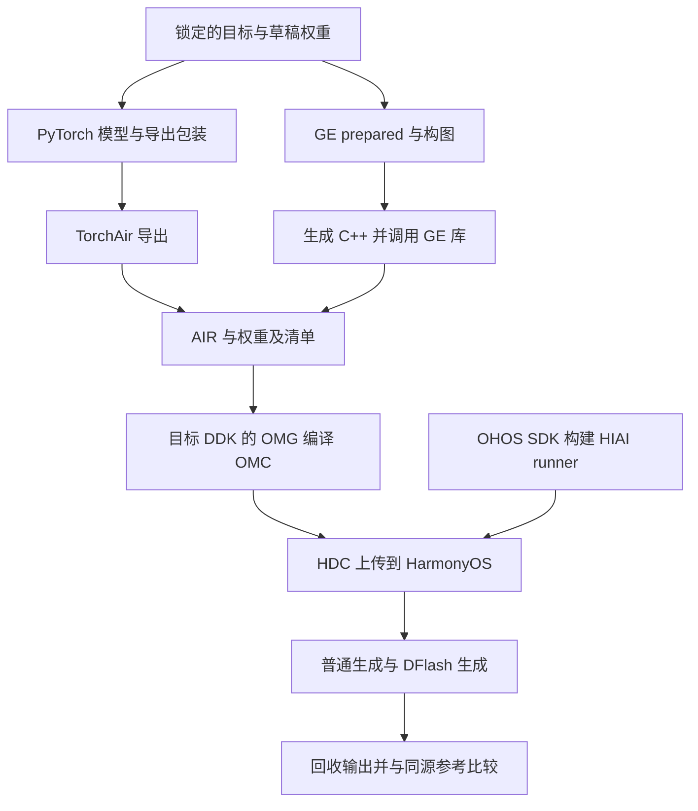

# 项目结构与端到端流程

[首页](README.md) · [模型结构](model-architecture.md) · [当前更新](current-status.md)

本项目包含目标模型、DFlash 草稿模型、两种构图方式，以及共用的编译和 HIAI 执行链。原始 ABI v2 双图只需选择 **PyTorch 或 GE 入口**，然后使用同一个板端入口；不用逐个调用内部模块。

## 目录与入口

```text
project.yaml                  工作区环境、目标与资源索引
specs/                        模型配置、权重版本、接口合同、当前验证记录
docs/README.md                文档首页
model/qwen35_moe_dflash/
  cli.py                      PyTorch 参考、导出、量化与结果比较入口
  model.py / graphs.py        原始 draft 与 target/draft 导出包装
  fused/                      新 PyTorch target：融合算子与显式状态
  ge_target.py / ge_draft.py  原始 GE target/draft 图
  ge_fused/                   新 GE target：可选融合与显式状态
  runtime.py                  主机普通生成与 DFlash 调度
  compile.py / hdc_run.py     OMG 编译与 HDC 执行的共用实现
reference/                    tiny、融合逻辑与中性 GE 的主机参考
targets/cpro/
  scripts/direct_model_air.py  GE 命令入口（含状态图与绑定生成）
  scripts/build_hiai.py        构建 HarmonyOS HIAI runner
  scripts/run_hdc.py           上传、执行、回收、比较
  scripts/prepare_blue_ddk.py  可选的工具链目录准备辅助
  runtime/                    板端 C++ 程序及其主机回归
tests/                        Python 模型、状态、导出与执行回归
```

权重、环境、构建目录、日志和历史探针归档均放在仓库外。本次合并了重复入口、权重加载与状态辅助文件；生产图的公共变换仍按职责保留，避免把模型数学、文件解析和设备执行混入一个大文件。

## 模型代码

以下路径以 `model/qwen35_moe_dflash/` 为起点。

| 文件/目录 | 功能 |
|---|---|
| `model.py`、`ops.py`、`config.py` | DFlash draft、其基础数学运算和配置；这里的 `model.py` **不是**完整 target 的定义 |
| `weights.py`、`checkpoints.py` | 按锁定版本加载上游 target 与本地 draft，核对检查点 |
| `graphs.py`、`target_features.py` | 包装 target/draft 的图输入输出，抽取 draft 需要的目标层特征 |
| `precision.py`、`export_moe.py` | 原 PyTorch 导出路径的精度及 MoE/位置计算改写 |
| `export.py` | 调用 TorchAir，生成 target/draft AIR 和产物清单 |
| `fused/model.py` | 加载 prepared 权重，按混合注意力+MoE结构执行新的 target 前向，检查算子返回的 shape/dtype |
| `fused/ops.py` | 外部完整基础后端及可选GDN/conv/RMS覆盖、模块ABI校验与调用 |
| `fused/session.py` | conv/recurrent/KV 状态、prefill/step、验证分支和接受前缀提交 |
| `fused/__init__.py` | 新模型的统一 Python 导入接口 |
| `quantization.py`、`reference_quant.py` | 已有 DOPT 量化候选及主机仿真；尚非文档 W4A8 的完整部署实现 |

新旧 target 实现独立保留。新路径中的主 RMSNorm 使用一次 `1+w`，GatedRMSNorm 使用 `w`，不照搬用户文档指出的重复折叠问题。具体结构见[模型介绍](model-architecture.md)。

## GE 构图代码

| 文件/目录 | 功能 |
|---|---|
| `ge_target.py`、`ge_draft.py`、`ge_moe.py` | 原始 target/draft/MoE 的基础算子图 |
| `ge_ir.py`、`ge_type_contracts.py` | 张量、节点、shape、dtype 和图接口检查 |
| `ge_export.py`、`ge_weights.py` | 准备同源权重、生成双图、组织 C++ 构建及 AIR 导出 |
| `ge_cpp.py`、`ge_recipe.py`、`ge_recipe_read.py` | 基础图落到 GE C++；图描述的保存、装载和主机读取 |
| `ge_constants.py`、`ge_matmul.py`、`ge_reduction_matmul.py` | 常量处理、矩阵运算及可选归约改写 |
| `ge_indexed_copy.py`、`ge_reshape_chains.py`、`ge_scan.py` | 模型仍在使用的索引复制、reshape 和 scan 变换 |
| `ge_eval.py`、`ge_reference.py`、`ge_target_features.py` | 同权重主机参考和目标特征对比 |
| `ge_fused/target.py`、`ge_fused/ir.py` | 新 target 的状态图、带多输出的节点与状态 ABI |
| `ge_fused/bindings.py` | 文档端口绑定生成、绑定校验、算子属性与 dtype 约束 |
| `ge_fused/emitter.py` | 融合节点及普通节点生成真实 GE 构图调用 |
| `ge_fused/recipe.py` | 新图描述的读写，含融合多输出信息 |
| `ge_fused/export.py`、`ge_fused/__init__.py` | 新状态图源码/AIR与单步输入产物编排及包入口 |

`--fused-ops none` 使用展开图，`gdn,conv_state,rms` 可按角色选择。绑定文件把逻辑角色映射到黄区算子的真实 GE 端口；它不会安装或实现 kernel。用法集中在 [GE 指南](ge-guide.md)。

## 执行与公共框架

| 文件/目录 | 功能 |
|---|---|
| `runtime.py` | Python executor、普通生成、草稿提案、target 验证及接受/拒绝调度 |
| `compile.py` | 调用目标 DDK 的 OMG，记录环境、命令、产物与编译诊断 |
| `hdc_run.py`、`hiai_deployment.py`、`elf_dynamic.py` | 校验并组织待上传文件、运行库依赖、HDC 执行及回收 |
| `artifacts.py`、`hashing.py`、`resources.py` | 产物合同、哈希与资源路径，避免混用不同权重或工具链产物 |
| `compile_inspect.py`、`compiler_evidence.py`、`compiler_support.py`、`omc_*.py` | 读取已有编译日志/OMC，辅助解释失败；不是要重复运行的算子探针 |
| `backends.py`、`diagnostics.py`、`tool_logs.py` | 参考后端选择、依赖检查和工具日志处理 |
| `targets/cpro/runtime/src/main.cpp` | 板端命令行、输入输出及结果报告 |
| `targets/cpro/runtime/src/generation.cpp` | 板端普通/DFlash 生成调度 |
| `targets/cpro/runtime/src/hiai_executor.cpp` | HIAI 模型加载、缓冲区管理和 Process 调用，含独立显式状态执行器 |
| `targets/cpro/runtime/src/sha256.cpp` | 板端文件摘要，绑定模型与输入输出 |

`reference/` 只负责主机对照；`tests/` 验证行为。测试中的 fake HIAI 只用于主机回归，不能当成板端执行结果。

## 端到端如何运行



这条已实现的共同执行链针对**原始 ABI v2 双图**。逐步操作如下：

1. **配置环境和权重**：按[环境配置](environment-setup.md)设置模型 Python、主机 GE/导出栈、目标 DDK 与 HIAI 资源。完整权重版本由 `upstream.lock.json` 锁定；tiny 使用固定的小模型配置。
2. **选构图方式**：按 [PyTorch 指南](pytorch-guide.md)或 [GE 指南](ge-guide.md)生成 target 和 draft。GE 先输出 prepared，再导出 AIR；PyTorch 由 TorchAir 捕获并转换。
3. **准备参考并编译**：参考必须来自本次对应权重、精度和接口。OMG 将两个 AIR 编译为 OMC。保留整套目录、外部权重及清单，不只复制一个 `.air` 文件。
4. **运行板端程序**：按[板端指南](board-guide.md)构建或复用 runner。上传 OMC、输入和配套运行库；板端不需要 PyTorch、TorchAir 或 CANN 编译工具。
5. **生成 token**：target 先处理 prompt，并产生下一 token 与选定层特征。draft 接收这些特征、已知 token 和 mask，提议后续 token；target 验证，调度器接受匹配前缀，在首个拒绝位置使用 target token，再进入下一轮。
6. **比较与计时**：回收 token、停止原因、调用计数和耗时，与同源参考比较。普通/DFlash 一致性和模型相对源模型的质量分别验证；精度通过后才评估配对条件下的加速。

旧 ABI v2 用固定长度 ND 输入和前缀重算维持语义，尚不消费新的显式缓存。新 `fused/` 已有主机会话和状态事务；新 `ge_fused/` 可导出带状态的 target AIR，独立编译与打包后由同一runner的 `--stateful-step` 模式执行，按文件接续prefill/decode。**常驻模型的状态bank和native DFlash调度尚待接通**；自动 `run_hdc.py` 仍只支持旧双图。单步进程重载模型，不代表最终解码性能。

在新实现中，prefill 的 conv/recurrent/KV 输出接下一步输入；DFlash 若只接受部分提案，提交状态必须对应接受前缀，不能使用整段验证后的末态。这里是后续端到端集成的关键，当前进展以[状态页](current-status.md)为准。
